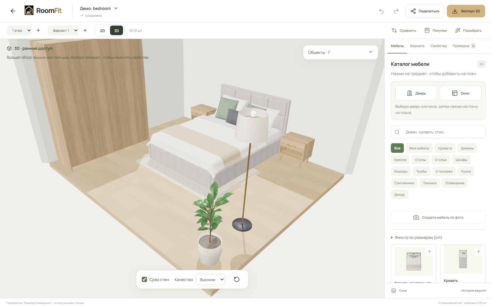

# RoomFit

Планировщик комнат с 2D-редактором, 3D-просмотром и личной мебелью из фотографий. Создай план по размерам, расставь мебель и проверь, поместится ли она в комнате.

[Сайт](https://roomfit.art) · [Открыть платформу](https://platform.roomfit.art) · [Локальный запуск](#локальный-запуск) · [Деплой на VPS](docs/deployment.md) · [История изменений](CHANGELOG.md)



## Структура проекта

| Папка            | Содержимое                                                                |
| ---------------- | ------------------------------------------------------------------------- |
| `landing/`       | Лендинг React / TypeScript / Vite, статические HTML на VPS                |
| `platform/`      | Авторизация, проекты, SVG-редактор и lazy 3D на React Three Fiber         |
| `packages/core/` | Каноническая модель в миллиметрах, геометрия, каталог, генератор шаблонов |
| `api/`           | FastAPI, SQLAlchemy, PostgreSQL, сессии, права, миграции Alembic          |
| `asset_factory/` | Blender: геометрия, PBR-текстуры, 2D-проекции и проверка моделей          |
| `assets/furniture/` | Исходники и проверенные версии базовой мебели; публичная копия — в `platform/public/` |
| `deploy/`        | Изолированный сервис VPS, Nginx, HTTPS и резервные копии                  |
| `docs/`          | ТЗ, инструкция деплоя, поведение и ограничения реализации                 |
| `claude design/` | Исходные дизайн-референсы                                                 |

Лендинг: **https://roomfit.art**, платформа: **https://platform.roomfit.art**. API: `/api/health` на домене платформы.

## Локальный запуск

Нужны Node.js ≥22.12 и Python ≥3.10. Установить Node и Python можно штатными установщиками; Docker не нужен.

```powershell
npm ci
npm run setup:api
npm run dev
```

- Лендинг: http://127.0.0.1:4178
- Платформа: http://127.0.0.1:4181
- API и документация: http://127.0.0.1:4182/api/docs

При первом запуске локально создаётся SQLite `api/data/roomfit.db`. На VPS используется отдельная PostgreSQL. Скопировать `api/.env.example` в `api/.env` нужно только для изменения настроек. Пароли и ключи в репозиторий не добавляются.

Для обычного редактора Blender и ключ Tripo не нужны. Для создания мебели по фото дополнительно запускается worker; параметры, Blender и лимиты кредитов описаны в [инструкции Tripo](docs/photo-furniture.md).

## Возможности

Регистрация и вход, приватные проекты, избранное, архив и корзина. Комнаты разных форм, много этажей, связанное редактирование вершин стен, двери и окна, мебель из общего и личного каталогов. Перемещение, поворот и размеры, группировка, блокировка, выравнивание, Undo/Redo, измерения, зоны, слои, подложка PNG/JPG/PDF и калибровка. Физические конфликты отделены от предупреждений о проходах. Варианты и сравнение, поиск подходящей мебели, предложения расстановок, покупки, PNG/PDF/SVG/JSON, печать и отзываемые ссылки для просмотра.

Автосохранение после 1,6 секунды без изменений, локальная резервная копия и проверка версии при записи. При конфликте вкладок нужно скачать локальный JSON и обновить проект; сервер не перезаписывает чужое сохранение молча.

3D использует тот же документ в миллиметрах: пол, объёмные стены с настоящими проёмами, GLB-мебель, Orbit-камера и общее выделение. Панель свойств, Undo/Redo и автосохранение работают между режимами. Прямое перетаскивание в 3D, Walkthrough, Split и экспорт 3D относятся к следующим этапам. Аудит и план внедрения: [docs/3d-integration.md](docs/3d-integration.md).

Asset Factory создаёт 26 согласованных предметов из спецификаций Blender: GLB, прозрачный вид сверху, технический SVG, 4 варианта материала, контуры и объёмы столкновений, превью и сравнительные листы. Вогнутый контур углового дивана и высота установки полки используются общим ядром. Сначала проверяется полный цикл на семи моделях, затем разрешается массовая генерация. Структура, команды и ограничения: [docs/asset-factory.md](docs/asset-factory.md). [Галерея ассетов](https://platform.roomfit.art/assets/furniture/index.html).

Базовые модели обновлены по фотографическим референсам: мягкая обивка, стёжка изголовья, драпировка постельного белья, изогнутые спинки стульев, тонкие металлические опоры и округлая сантехника. GLB содержит текстуры цвета, нормалей и шероховатости; 3D-сцена использует студийные отражения и текстуры пола. В старом проекте нажми «Обновить мебель»: позиции, ширина, глубина и личная форма сохраняются; для высоты, совпадающей с прежней каталожной, применяется новая каталожная высота. Действие поддерживает Undo/Redo. Старые версии доступны для ранее сохранённых проектов.

Студийная библиотека содержит 26 моделей с процедурными PBR-материалами и 104 согласованных вида сверху. Страницы `/furniture` и `/furniture/:id` дают просмотр моделей, выбор материала, 2D-проекции и отчёты проверки. Базовая библиотека хранится в Git; личные фото и сгенерированные через Tripo модели — в приватном хранилище API.

Подробности и границы алгоритмов: [docs/implementation.md](docs/implementation.md). Почтовое восстановление включается после подключения SMTP. OAuth и платежи не подключены; тарифы в ТЗ обозначены как гипотеза.

«Моя мебель → Создать 3D по фото» восстанавливает личную мебель через Tripo v3: 1–4 фото, размеры, проверка результата, согласованный вид сверху и GLB, сохранение в личный каталог и комнату. Обработка идёт отдельным worker с постоянной очередью и лимитами расходов. Настройка, ограничения и деплой: [docs/photo-furniture.md](docs/photo-furniture.md).

## Проверки

```powershell
npm run build
npm test
npm run test:api
api/.venv/Scripts/python.exe -m pytest -q asset_factory/test_validation.py
npx playwright install chromium
npm run test:e2e
npx playwright test --config playwright.photo.config.ts
npm run test:landing
npm run test:seo --workspace @roomfit/landing
```

На Linux для проверки фабрики используй `api/.venv/bin/python`. Браузерные сценарии мебели по фото запускаются отдельной командой: API 4192, preview 4193, изолированная тестовая БД и фиктивный провайдер. Они не используют настоящий ключ Tripo и не расходуют кредиты. Обычный `test:e2e` эти сценарии исключает.

После изменения модели или встроенных шаблонов выполнить `npx tsx scripts/export-schema.ts` и сохранить обновлённые файлы API. Новые изменения БД оформлять миграцией Alembic, а не правкой существующей миграции.

## Деплой

Пошаговая инструкция: [docs/deployment.md](docs/deployment.md). Лендинг: **https://roomfit.art**, платформа: **https://platform.roomfit.art**. Оба фронтенда раздаёт Nginx на VPS; API работает сервисом `roomfit-api`, база — PostgreSQL. DNS настроен в Namecheap, HTTPS выпускает Let's Encrypt.

Обновление обоих фронтендов из Windows: `./scripts/deploy-web.ps1` — сборка, загрузка через PuTTY и переключение на новый релиз.

Лендинг и инструкции собираются в готовые HTML-страницы. SEO, Search Console, Bing, IndexNow и агрегированная статистика: [docs/seo.md](docs/seo.md). План следующих материалов и черновики публикаций: [docs/seo-content-plan.md](docs/seo-content-plan.md).

## Документация

| Тема | Инструкция |
| --- | --- |
| Окружение, домены, HTTPS и резервные копии | [Деплой](docs/deployment.md) |
| Мебель по фото, очередь и бюджет Tripo | [Личная мебель](docs/photo-furniture.md) |
| Генераторы, текстуры, версии и проверки GLB/2D | [Asset Factory](docs/asset-factory.md) |
| Архитектура 3D и следующие этапы | [3D-интеграция](docs/3d-integration.md) |
| Поведение редактора и ограничения | [Реализация платформы](docs/implementation.md) |
| Индексация и поисковое продвижение | [SEO](docs/seo.md) |

Исходные фотографии, `.env`, базы данных, личные модели и временные артефакты не публикуются в Git. При переносе VPS нужно восстановить согласованную резервную копию базы и приватных файлов: одного клонирования репозитория для личной мебели недостаточно.
