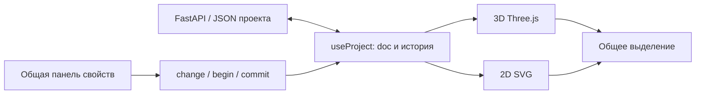

# Интеграция 3D в RoomFit

## Аудит текущего продукта

| Область   | Реальное состояние                                                                                                                    | Что переиспользуем                                                                                                               |
| --------- | ------------------------------------------------------------------------------------------------------------------------------------- | -------------------------------------------------------------------------------------------------------------------------------- |
| Frontend  | React 19, TypeScript, Vite. SVG-редактор в platform/src/Editor.tsx, рисунок в Plan.tsx                                                | Приложение, авторизация, навигация, каталог, Inspector и режим просмотра чужого проекта                                          |
| Документ  | packages/core/src/model.ts: schemaVersion 1; floors с комнатами, стенами и openings; variants с предметами                            | Единственная модель для всех представлений                                                                                       |
| Размеры   | Миллиметры, мебель задаётся центром x/y, углом в градусах, width/depth/height                                                         | Перевод в метры только при построении Three.js-сцены                                                                             |
| Комнаты   | Полигон внутреннего контура, высота, четыре покрытия пола                                                                             | Shape/ExtrudeGeometry для пола; стены остаются на тех же координатах                                                             |
| Стены     | Начало/конец, толщина, высота, roomId и цвет. Стена комнаты растёт наружу от внутренней границы; свободная стена — по обе стороны оси | wallPolygon и соединения в том же соглашении; нельзя ставить все стены по центру внутреннего контура                             |
| Проёмы    | door, double, sliding, window; offset, width, height, sill, flip, inward                                                              | Геометрическое вырезание вертикальных интервалов стены, затем створки/рамы                                                       |
| Мебель    | 24 предмета каталога, личная мебель, контуры, блокировка, группы и варианты                                                           | Параметрическая стартовая геометрия по реальным габаритам; затем модельный реестр GLB                                            |
| Изменения | useProject: change/begin/commit, общий Undo/Redo, автосохранение, восстановление и контроль версии                                    | Любое редактирование 3D должно проходить через эти же команды                                                                    |
| Проверки  | analyzeFloor и snap в общем ядре; геометрия пересечений и проходов сейчас плановая                                                    | Общая подсветка в обоих видах. Высотную проверку расширять отдельно, не выдавать текущие 2D-пересечения за полноценную 3D-физику |
| API и БД  | JSON-документ в PostgreSQL, JSON Schema и дополнительная геометрическая проверка FastAPI                                              | Для первого этапа формат документа и БД не меняются                                                                              |
| Экспорт   | PNG/PDF/SVG/JSON для 2D                                                                                                               | Отдельный экспорт 3D-ракурса на следующем этапе; существующий экспорт сохраняется                                                |

## Архитектура

Editor и useProject остаются владельцами doc, выделения и истории. 2D PlanContent и новый Scene3D читают один floor и один variant. Переключение меняет только представление, без повторного запроса проекта и пересоздания store. Локальное состояние камеры не входит в геометрию проекта.

Новый код изолирован в platform/src/three. Движок загружается через React.lazy при выборе 3D. Zustand не добавляется: второй store сейчас создаст лишнюю точку синхронизации. React Three Fiber 9 соответствует установленному React 19; Drei даёт контроллер камеры. WebGL2 проверяется отдельно, ошибки контекста не должны удалять проект или мешать возврату в 2D.

## Компоненты и ответственность

- Scene3D: Canvas, загрузка, WebGL-fallback, настройки обзора, освобождение ресурсов.
- SceneGeometry: чистое преобразование миллиметров, углов и геометрии стен/пола; тестируем отдельно от GPU.
- RoomMesh / WallMesh: пол, настоящие проёмы, стыки, высота и скрытие заслоняющих стен в макете.
- FurnitureMesh: параметрические стартовые модели с правильной привязкой и размерами; неизвестный тип имеет объёмный fallback.
- CameraRig: обзор, возврат к исходному виду и сенсорные OrbitControls.
- Позже: FurnitureTransform, ModelRegistry/GLBAsset, MaterialLibrary, WalkthroughControls, SplitViewport и SceneExport.

## Модели данных

Первый этап использует существующие height, color, floor, contour и opening-параметры. Новых полей и миграции БД для просмотра не требуется. Личные проекты schemaVersion 1 продолжают открываться.

Для следующих этапов потребуются обратно совместимые необязательные данные: GLB URL/версия и тип fixed/scalable/parametric у каталога; материалы и освещение в документе; высота установки мебели над полом; открытый проём и варианты оконной рамы. Изменения проводить одновременно в Zod, экспортируемой JSON Schema и проверках API. Старые проекты должны получать значения по умолчанию. Тяжёлые модели не хранятся в JSON.

Высота комнаты и отдельной стены уже независимы. При редактировании высоты комнаты связанные стены с прежней высотой комнаты должны обновляться вместе; специально пониженные или отдельно изменённые стены сохраняют свою высоту.

## Этапы и проверки

1. Аудит и архитектура — этот документ.
2. Первый рабочий этап: 2D/3D, реальная сцена, пол, стены, габариты мебели, камера, общее выделение и панель свойств, fallback WebGL. Проверить масштаб, смену этажей/вариантов, сохранение и Undo/Redo; убедиться, что движок не попадает в первоначальную загрузку 2D.
3. Уточнение помещения: все виды проёмов и рам, потолок, сложные стыки и диагностика некорректных высот.
4. Модельный каталог: оптимизированные GLB, версии, лицензии, кэш, fixed/scalable/parametric и fallback. Не растягивать сложный fixed-объект незаметно для пользователя.
5. Прямое редактирование в 3D: перемещение по полу, вращение, точные размеры, привязки; begin/commit образуют одну запись Undo на жест.
6. Материалы, свет, качество и камеры: пресеты PBR, высотные столкновения, Dollhouse/Top/Walkthrough, проверка прохода камеры через двери.
7. Split с регулируемым разделителем, сохранённые ракурсы, PNG выбранного разрешения, мобильные инструменты и нагрузочная проверка.

После каждого этапа: TypeScript/production build, тесты чистой геометрии, подходящие браузерные проверки, регрессии 2D и API при изменении схемы. Первый этап — начало интеграции, а не готовность всего ТЗ из prompt.txt.

## Выполненный первый рабочий этап

Добавлен базовый 3D-просмотр в существующий Editor. Полы прямоугольной, Г- и П-образной формы, наружная толщина и соединения стен, реальные отверстия под двери и окна, створки, рамы и 24 параметрических прототипа мебели строятся из общего документа. Контуры личной мебели имеют объёмный fallback. Материалы используют MeshStandardMaterial, пол — процедурную текстуру, освещение — hemisphere и directional с тенями.

Доступны Orbit-камера, срез заслоняющих стен, ручное качество, возврат камеры и список объектов. Выделение мышью/тапом открывает общий Inspector; размеры, положение, поворот, цвет, Undo/Redo и сохранение продолжают работать в обоих видах. Скрытая стена и контуры подсветки не перехватывают выбор мебели. При отсутствии или потере WebGL доступен возврат в 2D.

Движок — отдельный lazy chunk, около 261 КБ gzip. Начальный JS 2D — около 160 КБ gzip; Three.js не загружается до выбора 3D. Геометрии, материалы и текстуры переиспользуются и освобождаются при выходе из редактора. Камера сохраняет ракурс при переключении 2D/3D и возвращается к исходному при сбросе, смене этажа или размера сцены. На мобильном экране по умолчанию выключены тени и DPR ограничен единицей. Экспорт верхней панели подписан «Экспорт 2D» при открытой 3D-сцене.

Проверки: production build обоих фронтендов; 35 unit-тестов; 18 сценариев платформы в Chromium desktop/mobile, из них 8 для 3D; 14 сценариев лендинга и 30 сценариев его production/SEO-сборки. 3D дополнительно проверен на собранном frontend, включая реальные raycast-нажатия, автосохранение, смену этажей и вариантов, общую высоту стен, readonly и потерю WebGL. WebGL в автоматических проверках использует SwiftShader; это не измерение производительности физических телефонов и не проверка Safari.

В первую поставку не входят GLB-каталог, прямой drag/manipulator в 3D, потолки, Split, Walkthrough, сохранённые ракурсы, PNG из 3D и высотная физика. Подсветка пересечений использует существующий анализ плана. Эти функции остаются отдельными этапами с последующим расширением данных и проверками.

## Риски

После первого этапа добавлен [Asset Factory](asset-factory.md): библиотека GLB и полученных из них видов сверху, общие материалы, версия ассета, высота установки, вогнутые/составные контуры и проверка интервалов деталей. Этот этап заменяет независимые визуальные прототипы для утверждённых предметов. Прямые манипуляторы, Walkthrough, Split и экспорт 3D остаются в отдельном плане.

- Оси и знак угла: X→X, Y→Z, миллиметры→метры, yaw Three.js имеет противоположный знак относительно положительного 2D-угла.
- Толщина наружных стен не должна уменьшать внутренние размеры комнаты. Соединения под острым углом требуют ограничения митера.
- Door/window должны вырезать стену; визуальная рама поверх сплошного объёма неприемлема.
- Один Canvas может потерять GPU-контекст на телефоне. Нужны ограничение DPR, рендер по запросу, явное освобождение и рабочий путь обратно к 2D.
- Изменение формата JSON на одном frontend приведёт к отказу API или потере полей при восстановлении. Схема обновляется согласованно.
- Плановая проверка пересечений не определяет все высотные ситуации. Это отдельное расширение общего ядра.
- GLB требуют проверки лицензии, масштаба, pivot, размера загрузки и стоимости GPU; полноценного проверенного GLB-каталога в текущем репозитории нет.

Технические ссылки: [React Three Fiber](https://r3f.docs.pmnd.rs/getting-started/introduction), [Canvas и обработка ошибок](https://r3f.docs.pmnd.rs/api/canvas), [Drei controls](https://drei.docs.pmnd.rs/controls/introduction).
