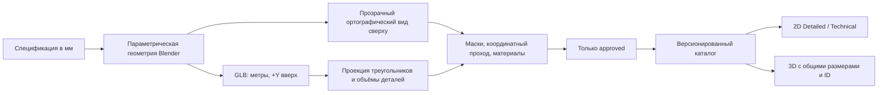

# RoomFit Asset Factory

## Архитектура и единый источник

До этой работы отдельной Asset Factory в репозитории не было: SVG-рисунки и объёмные прототипы создавались разными функциями. Теперь библиотека строится из `asset_factory/specifications.json` и `blender_generate.py`. Параметрическая спецификация задаёт размеры, конструкцию, установки и материалы; нормализованная коллекция Blender является источником GLB, ортографических изображений и геометрических метаданных. Фабрика работает локально и не нагружает production VPS рендерингом.



Параметрические модели создаются кодом, включая скругления, швы, подушки, ножки, фурнитуру и общие PBR-материалы. Изображения не генерируются отдельной AI-моделью. Новые типы нужно добавлять в спецификации и в генератор; неизвестный тип не получает статус approved через экспорт произвольного куба.

## Координаты и размеры

- Проект хранит миллиметры; X/Y — центр предмета на плане, `elevation` — высота основания над полом.
- GLB хранит метры: X — ширина, Y — высота, Z — глубина. Front = +Z, Back = −Z, Up = +Y. Pivot — центр основания.
- Положительный угол плана превращается в отрицательный Three.js yaw. Тестируются 0°, 45°, 90°, 180° и 270°.
- Blender использует X/−Y/Z, затем его glTF-экспортёр переводит результат в X/Y/Z. Верхняя сторона изображения соответствует задней стороне мебели; нижняя — передней.
- Пиксели превью не определяют физические размеры. `top_frame_mm` описывает ортографический кадр; renderer размещает его относительно размеров модели.

Авторские параметры меняются в спецификации. Сгенерированные модели текущей библиотеки помечены `scalable`: изменение габаритов экземпляра масштабирует GLB, top-view, контуры и объёмы одинаково. Это явно обозначено в панели свойств. Структура также предусматривает `fixed` и `parametric`; API запрещает изменение размеров fixed-модели. Здесь не заявляется перестроение конструкции сложного GLB при каждом движении ползунка.

## Структура и выходные файлы

```text
asset_factory/
  specifications.json      # источник параметров
  specifications.ts        # первоначальное создание спецификаций из старого каталога
  blender_generate.py
  blender_appliances.py     # конструктивные детали фасадов бытовой техники
  blender_interiors.py      # мягкая мебель, бельё, столы и изогнутые поверхности
  blender_floor_lamp.py     # физические опоры полого тканевого абажура
  blender_appliance_interiors.py # крепления фасадных деталей и ручек техники
  floor_materials.py       # текстуры дерева и плитки для 3D-сцены
  validation.py
  pipeline.py
  asset.schema.json
assets/furniture/<category>/<asset_id>/<generation_version>/
  source/specification.json
  source/model.blend
  source/render-provenance.json
  source/export-provenance.json
  3d/model.glb
  2d/<material>/top_view_1024.png
  2d/<material>/top_view_512.webp
  2d/<material>/top_view_256.webp
  2d/<material>/top_view_128.webp
  2d/technical.svg
  previews/front.webp
  previews/side.webp
  previews/isometric.webp
  validation/coordinates.png
  metadata.json
  validation.json
  comparison.jpg
```

1024/512/256/128 обозначают максимальную сторону: исходное соотношение ширины и глубины сохраняется. PNG и WebP имеют альфа-канал. Сравнительный лист содержит оба представления, размеры, категорию, число треугольников, размер GLB и результат проверки. Общие contact sheets доступны по категориям. Для runtime публикуются GLB, изображения, SVG, метаданные и отчёты в `platform/public/assets/furniture`; `.blend` и исполняемые генераторы на web-сервер не выкладываются.

`asset_id` и `generation_version` одинаковы во всех производных файлах. Версия включает хеш спецификации, общего генератора, подключённого генератора категории и алгоритма проверки. Утверждённые версии неизменяемы; для изменения создаётся новая версия. Архив метаданных позволяет открывать экземпляры с ранее сохранённой версией. Расширение бытовой техники проходит общий цикл нормализации, рендера и проверки; исправление фасадов этой категории не изменяет версии диванов и кроватей.

## Проверки до публикации

Проверка читает фактически экспортированный GLB, включая вложенные матрицы объектов и бинарные позиции/индексы. Из проекций его треугольников извлекаются `visual`, `collision`, отверстия и составные контуры. `volumes` содержат контуры и вертикальные интервалы отдельных конструктивных деталей. `clearance_zones` сохраняются отдельно от физических контуров.

Автоматические условия approved:

- Расхождение габаритов и pivot не превышает 1 мм.
- Совпадение геометрической маски GLB и alpha top-view — минимум 97% IoU для каждого материала. Декоративные тени не участвуют в сравнении.
- Все варианты имеют одинаковую геометрическую alpha-маску.
- Специальный координатный render pass исключает зеркальный и перевёрнутый вид даже для симметричных объектов. Допуск учитывает 8-битный sRGB; точность размеров проверяется отдельно по GLB.
- Основной PBR-слот сохранил заявленный цвет; параметры материалов совпадают между runtime и авторским renderer.
- Повороты на пяти углах совпадают в обоих соглашениях координат.
- Конструктивные детали образуют связную сборку: нет отдельных ножек в пустом месте. Для проверки используются интервалы высоты и проекции деталей с небольшим допуском на соединение.
- Контуры непустые и валидные; метаданные проходят JSON Schema.
- Не превышены 60 000 треугольников и 4 МБ на GLB.
- Хеши исходных GLB, top-view и координатного прохода соответствуют результатам того же запуска renderer. Изменённую вручную картинку нельзя повторно одобрить как неизменённый результат.
- Публикация и повторное использование кэша проверяют также хеши производных WebP, SVG, превью и исходного `.blend`. Изменённый после проверки runtime-файл останавливает публикацию.

Негативные тесты проверяют зеркальный проход, удалённую часть силуэта, подменённый цвет, неверные размеры и отделённую конструктивную деталь. Визуальный просмотр сравнительных листов дополняет геометрические проверки: совпадение двух неправильных ассетов само по себе не доказывает качество.

## Интеграция редактора

`packages/core/src/assets.ts` — общий реестр approved-моделей. Каталог и экземпляры связываются через `assetId`, `assetVersion`, `materialVariant`; UUID самого Furniture не меняется при переключении вида. Новые поля необязательны и совместимы с JSON-проектами schemaVersion 1. Колонки БД не менялись.

2D по умолчанию использует Blender WebP; каталожный thumbnail — 128, план — 512, экспорт — PNG 1024 с изображением внутри итогового SVG/PNG/PDF. Technical использует отдельный SVG, построенный из тех же контуров. Материалы переключают заранее отрендеренные изображения, без CSS-перекрашивания сложных текстур. GLB загружается только при открытии 3D и только для предметов сцены. Экземпляры и материалы используют одну загрузку файла, общий кэш геометрии и текстур, с освобождением ресурсов при выходе.

При смене материала 3D переиспользует тот же GLB и меняет основной материал; геометрия и коллизии сохраняются. Размеры, поворот, высота установки, вариант, Undo/Redo, автосохранение и Inspector общие с 2D. Произвольный старый цвет или пользовательский контур сохраняются через технический fallback из общего набора примитивов; они не выдаются за утверждённую модель. Ошибка загрузки GLB показывает упрощённый объём и сообщение.

«Обновить мебель» переводит предметы текущего варианта на актуальные модели явным действием через общий Undo/Redo. Сохраняются UUID, размеры, координаты, поворот, высота установки, блокировка и список покупок. Старый стандартный контур заменяется актуальным; личная форма и личный каталог сохраняются. Материал сохраняется по имени варианта, а произвольный старый цвет сопоставляется с ближайшим поддерживаемым оттенком. Старые approved-файлы остаются доступными для Undo, readonly-ссылок и сохранённых проектов. Пока 3D скрыт, добавление предмета в 2D не запускает новый запрос GLB.

Общее геометрическое ядро учитывает составные проекции, вогнутые формы и вертикальные интервалы. Пустой угол Г-дивана доступен для другой мебели; настенная полка не блокирует диван ниже неё и не вычитается из свободной площади пола. Зоны обслуживания фабричного шкафа находятся перед фасадом. Проверка объёмов использует вертикальные интервалы деталей и их проекции; это не расчёт упругих поверхностей или физический симулятор.

## Запуск и порядок расширения

Нужны Blender 4.5 LTS, Python ≥3.10 и библиотеки из `asset_factory/requirements.txt`. Переменная `ROOMFIT_BLENDER` или `--blender` задаёт путь к Blender. В этой рабочей копии portable Blender размещён в игнорируемой `.local/tools`.

На совместимой видеокарте можно задать `ROOMFIT_CYCLES_DEVICE=OPTIX` (NVIDIA) или другой поддерживаемый Cycles backend. По умолчанию используется CPU. Сначала проверь доступность и свободную память устройства; рендер и тяжёлые браузерные тесты лучше запускать последовательно.

```powershell
# В первый раз: добавить начальные параметры старого каталога.
npx tsx asset_factory/specifications.ts
# Полный цикл сначала на одном диване.
api/.venv/Scripts/python.exe asset_factory/pipeline.py generate --asset sofa
npx tsx scripts/export-schema.ts
npx playwright test platform/tests/asset-factory.spec.ts
# Семь обязательных моделей, включая Г-диван и настенную полку.
api/.venv/Scripts/python.exe asset_factory/pipeline.py generate --phase pilot
npx tsx scripts/export-schema.ts
npx playwright test platform/tests/asset-factory.spec.ts
api/.venv/Scripts/python.exe asset_factory/pipeline.py approve-pilot
# Блокируется без успешного полного desktop/mobile цикла текущих версий.
api/.venv/Scripts/python.exe asset_factory/pipeline.py generate --phase all
api/.venv/Scripts/python.exe asset_factory/pipeline.py validate --phase all
api/.venv/Scripts/python.exe -m pytest asset_factory/test_validation.py -q
npx tsx scripts/export-schema.ts
npm test
npm run test:api
npm run build
npm run test:e2e
```

При изменении параметров/генератора сначала повторяются pilot и browser proof; старое подтверждение не разрешает массовую генерацию новых версий. `--force` не перезаписывает approved-версию. Обновление публичного каталога выполняется отдельно: `python -m roomfit.seed --refresh-catalog`; личная мебель и проекты не переписываются. Backend должен получить совместимую JSON Schema и реестр до публикации нового frontend.

Фабрика не использует внешние AI-GLB в текущей поставке. Если они появятся, их нужно вводить через нормализацию, проверку происхождения/лицензии и этот же ортографический и геометрический этап; отдельная AI-картинка для 2D не допускается.

## Проверенная поставка 14 октября 2026

В каталоге 26 approved-моделей и 104 согласованных варианта вида сверху. Минимальный silhouette IoU — 0,99584; максимальная ошибка габаритов GLB — 0,000161 мм. Все GLB вместе занимают 2 884 240 байт, максимальный файл — 220 764 байта. Просмотрены сравнительные листы семи пилотных предметов и contact sheets всех 14 категорий; после просмотра отдельно исправлены фасады холодильника, стиральной машины и плиты.

Пройдены 46 unit-тестов ядра и 3D-геометрии, 14 тестов API, 7 проверок фабрики, 12 браузерных сценариев 3D/ассетов на production-сборке и 8 сценариев основного редактора. Проверены переключение видов, реальные GLB, материалы, общий ID, сохранение/открытие, экспорт со встроенными изображениями, отказ загрузки модели, readonly и потеря WebGL. Для изменённых текстов лендинга пройдены 30 production-проверок интерфейса и SEO. Браузерные 3D-проверки используют Chromium/SwiftShader и мобильный viewport; это не замер GPU реального телефона.

## Обновление моделей по фотографиям

Референсы из локальной папки `photos/` используются для выбора конструкции: мягкое изголовье и стёжка, объёмные подушки, драпировка одеяла, металлические U-образные опоры столов и изогнутая обивка стульев. Картинки референсов остаются в локальной папке. Форма создаётся сетками и кривыми Blender; текстуры цвета, нормалей и шероховатости генерируются детерминированно и упаковываются в GLB.

Одеяло следует аналитической поверхности матраса, а сложенный плед — поверхности одеяла, с учётом толщины ткани. Металлические детали, дерево, ткань и керамика имеют отдельные физические материалы. Нормализация выполняется по реальным вершинам: углы bounding box наклонной ножки не принимаются за физическую границу. В 3D добавлено локальное студийное окружение для отражений, мягкая фильтрация теней и текстуры пола. Окружение не зависит от внешнего HDR-сервиса; его render target и загруженные текстуры освобождаются при закрытии сцены.

## Проверенное обновление 15 октября 2026

Все 26 моделей созданы заново; опубликованы 104 согласованных вида сверху и 12 карт пола. Минимальный silhouette IoU — 0,99372; максимальная ошибка габаритов — 0,000146 мм. Максимум — 33 556 треугольников и 1 970 924 байта на GLB; сумма моделей — 21 686 772 байта. GLB загружаются по предметам открытой 3D-сцены. Предыдущие 26 approved-версий сохранены; неопубликованные промежуточные модели остаются вне репозитория.

Предупреждение об узком проходе сохраняется в проверках плана, но не рисует объёмную рамку вокруг каждого предмета в 3D. Рамка показывается для выбора и физических столкновений. Отдельно просмотрена реальная сцена редактора с восемью моделями на десктопе и мобильном viewport, включая сохранённый ковёр с нулевой высотой.

Пройдены 49 unit-тестов, 14 тестов API, 10 проверок фабрики и повторная валидация всех 26 моделей. На production-сборке проверены 14 браузерных сценариев ассетов/3D, 8 сценариев редактора и 2 сценария публичных шаблонов. Проверка старой комнаты включает обновление версий, сохранение размеров и положения, Undo/Redo, сохранение после перезагрузки, неизменность личной формы и отсутствие новых запросов GLB в скрытом 3D. Применяется Chromium/SwiftShader с десктопным и мобильным viewport; это не измерение производительности настоящего телефона.
